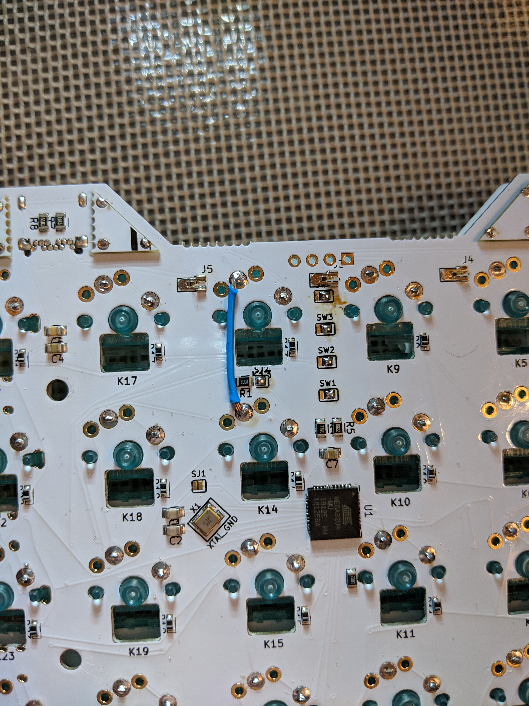

# Zygomorph Wiring Workaround

## Status: Firmware and Photographic Beta-Fix References Available

This fork supports a Zygomorph with a board-specific wiring workaround. Two historical photos in `keyboards\rgbkb\zygomorph\beta_fix` now document the physical fix: an annotated reference marks **two trace-cut locations**, and a board photo shows an installed **blue jumper between two switch solder pads**. These provide physical landmarks missing from the original firmware notes. Exact electrical net identities and which halves received the repair still require inspection or continuity testing.

## Confirmed Pin Assignments

The keyboard uses an ATmega32U4. QMK names such as `D5` and `B7` mean AVR port pins **PD5** and **PB7**, not Arduino digital pin numbers or MCU package pin numbers.

| Signal | This fork | Current upstream |
| --- | --- | --- |
| Matrix columns, in order | `F4, F6, C7, D5, B6, D4` | `F4, F6, C7, C6, B6, D4` |
| Fourth matrix column, zero-based index 3 | **D5 / PD5** | **C6 / PC6** |
| RGB LED data output | **B7 / PB7** | **B7 / PB7** |
| Matrix rows, in order | `F1, F5, F7, B5, B4` | Same |
| Split serial connection | `D3 / PD3` | Same |
| Encoder inputs | `D2 / PD2`, `D7 / PD7` | Same |

The firmware keeps the fourth **key-matrix column** on D5 and the **RGB data signal** on B7. The photos alone do not establish the electrical cause of the beta-board fault. This is not the single-color `BACKLIGHT_PIN` feature: the old Zygomorph config only had a commented-out `BACKLIGHT_PIN B7`, while its active RGB data pin was `B7`.

## Evidence in the Original Fork

The initial Zygomorph commit, `44c98a86075073a98b55cf6b1423d864c96b5d93` from January 24, 2019, contains this in `keyboards\zygomorph\rev1\config.h`:

```c
#define MATRIX_COL_PINS { F4, F6, C7, D5, B6, D4 }
//Enable the top line when we've got D5 working properly
//#define MATRIX_COL_PINS { F4, F6, C7, B7, B6, D4 }
```

The same file has the active definition:

```c
#define RGB_DI_PIN B7
```

This preserves two important clues: `B7` was an alternative fourth-column assignment in the early firmware, and `D5` was the intended replacement. The comment explicitly says D5 still needed to be made to work. It does **not** establish when the hardware repair was completed or how it was soldered.

The original README describes an early/prototype build. By the first official upstream Zygomorph addition, commit `8d46bb9cab` in [qmk/qmk_firmware#5841](https://github.com/qmk/qmk_firmware/pull/5841), the fourth column was already `C6`, with RGB still on `B7`. Consequently, the production build guide and current upstream firmware should not be assumed to describe this board's repair.

## Physical Beta Fix Shown in the Photos

### Annotated Reference: Two Trace Cuts

[Open the original annotated reference](<keyboards/rgbkb/zygomorph/beta_fix/clip+(2019-01-21+at+10.40.09).jpg>).

.jpg>)

Orient the reference with the **J24** four-hole footprint along the top edge and the visible RGB LED packages below it. There are two separate green circles, each containing a red cut marker:

1. **Upper cut marker:** immediately to the right of the upper-right RGB LED opening, between the small round hole beside that opening and the angled three-hole switch-pad group above it. The red line crosses the narrow trace near the opening's upper-right corner.
2. **Lower cut marker:** below that same LED opening, just above the next angled three-hole switch-pad group toward the bottom-right of the image. The horizontal red line marks the second trace interruption.

The red lines identify intended cut positions; the annotated photo is not a continuity measurement or proof that the traces have already been severed. Match the PCB features and revision, not just the approximate image coordinates. Do not cut the surrounding wider trace bundle.

### Installed Jumper: Between Switch Pads

[Open the original installed-jumper photo](keyboards/rgbkb/zygomorph/beta_fix/IMG_20190122_224227.jpg).



Orient this photo with the notched PCB edge at the top and the **U1 ATmega32U4** near the lower-right of the jumper. The blue insulated wire runs vertically between two adjacent switch positions:

| Jumper end | Visible attachment point |
| --- | --- |
| Upper end | Filled switch solder pad immediately to the right of **J5**, above the upper switch opening and left of the **SW3** area; the upper footprint's K13 label is partly obscured near R1 |
| Lower end | Filled switch solder pad below **R1** and above the **K14** switch opening, left of **R5/C7** |

Both wire ends are attached to **switch pads**, not visibly to an MCU leg. The image does not identify either pad's AVR port net. The earlier reconstruction of a column reroute to D5 did not establish these physical endpoints and should not be treated as an instruction to solder directly to the MCU.

### Relationship to the Firmware

The confirmed firmware assignments remain:

```text
PD5 / D5: fourth matrix column
PB7 / B7: RGB LED data output
```

The two cuts and switch-pad jumper are the photographed beta-board repair. Their exact net-level relationship to D5 and B7 has not been established by a matching schematic or continuity measurements. Do not assume that either visible jumper endpoint is directly connected to D5, or that either marked cut severs a B7 connection, solely from the pin definitions.

## Recovering the Physical Details

Inspect the existing repair before changing anything. Disconnect power and cables from both halves before checking continuity.

1. Record each PCB's revision markings and compare its physical landmarks with both reference photos. Check both halves independently; the photos do not establish that both were modified.
2. Locate the two marked trace positions on the actual board and inspect for existing cuts. Use unpowered continuity measurements to confirm each interrupted path is open.
3. Identify the two jumper pads using the J5, R1, SW3, and K14 landmarks above. Confirm the installed jumper connects those pads; then identify their electrical nets with a matching schematic or continuity testing. Do not substitute an Arduino pinout or guess the ATmega32U4 package pin numbers.
4. Check the fourth-column path to PD5 and the separate PB7 RGB data-input path. Account for switches, diodes, resistors, and other components when interpreting readings.
5. Record the measured nets and affected halves here. If the observed routing differs from an earlier hypothesis, preserve the observation rather than modifying the board to fit that hypothesis.

| Physical detail | Current record |
| --- | --- |
| Exact PCB revision / prototype identifier | Not recorded |
| Trace-cut locations | Two positions marked in the annotated J24/RGB-LED reference above; completion and electrical nets unverified |
| Upper jumper endpoint | Switch solder pad right of J5, above the upper switch opening; electrical net unverified |
| Lower jumper endpoint | Switch solder pad below R1 and above K14; electrical net unverified |
| Modified half or halves | Not recorded |
| Close-up photos | Both original JPGs preserved in `keyboards\rgbkb\zygomorph\beta_fix` |
| Matching schematic / continuity results | Not available in this repository |

The manufacturer guide also describes **USB-routing solder jumpers**, a **MASTER jumper**, and reset pads. These are separate setup features and are not evidence of the matrix/RGB trace repair.

## Firmware to Use

The migrated keymaps include `keyboards\rgbkb\zygomorph\common\fork_config.h`, which overrides the fourth column to D5. RGB remains on B7 through `keyboards\rgbkb\zygomorph\rev1\keyboard.json`.

From QMK MSYS at the repository root:

```sh
qmk compile -kb rgbkb/zygomorph/rev1 -km gmoney
qmk compile -kb rgbkb/zygomorph/rev1 -km legacy_default
qmk compile -kb rgbkb/zygomorph/rev1 -km kageurufu
```

Use `legacy_default` for this fork's original default layout. **Do not use upstream's `default` or `default_oled` for the D5-modified board:** they use the upstream C6 column assignment and do not include this override.

OLED support can be enabled with `-e OLED_ENABLE=yes`; these builds disable the debug console to fit in flash. Handedness uses `EE_HANDS`, so each half needs the correct existing EEPROM handedness setting.

After confirming the hardware and installing matching firmware, test every key, especially the repaired switch positions and the fourth column on both halves, and test RGB operation. In the `gmoney` QWERTY layout, the top-row keys in that column are `3` on the left and `9` on the right. Compilation verifies software compatibility, not the physical cuts or jumper.

## Sources

- [Annotated beta-fix photo](<keyboards/rgbkb/zygomorph/beta_fix/clip+(2019-01-21+at+10.40.09).jpg>): two marked trace-cut locations near the J24 footprint and RGB LED openings.
- [Installed-jumper photo](keyboards/rgbkb/zygomorph/beta_fix/IMG_20190122_224227.jpg): blue wire between switch pads near J5/R1/K14, with U1 visible for orientation.
- [Original fork config at commit 44c98a8607](https://github.com/dgrif/qmk_firmware/blob/44c98a86075073a98b55cf6b1423d864c96b5d93/keyboards/zygomorph/rev1/config.h): active D5 column, commented B7 alternative, and active B7 RGB output.
- [Original fork README](https://github.com/dgrif/qmk_firmware/blob/44c98a86075073a98b55cf6b1423d864c96b5d93/keyboards/zygomorph/readme.md): early build notes and USB/MASTER/reset jumpers.
- Local `keyboards\rgbkb\zygomorph\common\fork_config.h` and `keyboards\rgbkb\zygomorph\rev1\keyboard.json`: preserved fork wiring and upstream hardware definition.
- [Official upstream introduction, qmk/qmk_firmware#5841](https://github.com/qmk/qmk_firmware/pull/5841): production firmware used C6 for the fourth column.
- [Manufacturer assembly guide](https://rgbkb.gitbook.io/rgbkb-build-guides/zygomorph-build-guide/assembly) and [flashing guide](https://rgbkb.gitbook.io/rgbkb-build-guides/zygomorph-build-guide/flashing): standard assembly and setup; no matching trace-cut/D5 repair instructions were found in their text.
